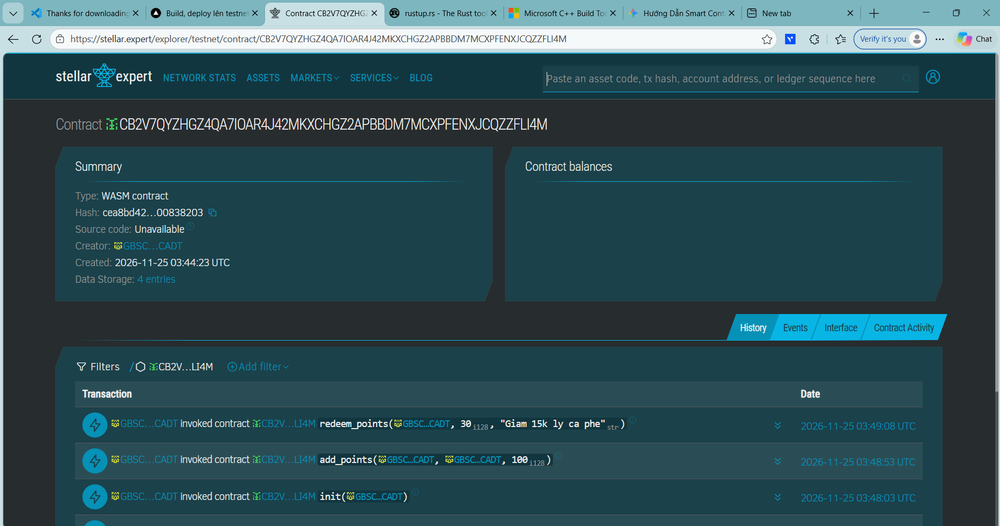

stellar keys address student ; Start-Process "https://stellar.expert/explorer/testnet/contract/CB2V7QYZHGZ4QA7IOAR4J42MKXCHGZ2APBBDM7MCXPFENXJCQZZFLI4M" ; @'
# Project Title

CafePoints

# Project Description

CafePoints is a Soroban smart contract on the Stellar network designed for a cafe loyalty program. It enables the shop owner (`admin`) to initialize the contract and award points to customers after purchases, while allowing customers to redeem their points for rewards and enabling anyone to query customer point balances and total points issued.

# Project Vision

To replace easily lost paper loyalty cards and make point tracking transparent and verifiable on-chain for cafes and their customers using Stellar smart contracts.

# Key Features

- One-time contract initialization (`init`) that sets the `admin` address and initializes total issued points to `0`.
- Admin-restricted point issuance (`add_points`) that credits positive `i128` points to a customer, updates `last_updated` with the ledger timestamp, and increments `TotalIssued`.
- Customer point redemption (`redeem_points`) that deducts points from the customer's balance for a `reward` string and updates `last_updated`, preventing redemptions exceeding the current balance or non-positive amounts.
- Public read methods (`get_points` and `get_total_issued`) to inspect a customer's current point balance and the cumulative points issued.
- Explicit contract error codes (`AlreadyInitialized`, `NotInitialized`, `Unauthorized`, `InvalidAmount`, `InsufficientPoints`) enforced via `Result` and `require_auth()`.

# Usage Instructions

Build the contract from the workspace:

stellar contract build

Deploy the compiled WASM to Stellar Testnet:

stellar contract deploy --wasm target/wasm32v1-none/release/hello_world.wasm --source-account student --network testnet --alias my-contract

Invoke the contract functions on Testnet (replace `student` and `my-contract` as needed):

stellar contract invoke --id my-contract --source-account student --network testnet -- init --admin student

stellar contract invoke --id my-contract --source-account student --network testnet -- add_points --admin student --customer student --points 100

stellar contract invoke --id my-contract --source-account student --network testnet -- redeem_points --customer student --points 30 --reward "Discount voucher"

stellar contract invoke --id my-contract --source-account student --network testnet -- get_points --customer student

stellar contract invoke --id my-contract --source-account student --network testnet -- get_total_issued

# Future Scope

- Reward catalog management and on-chain redemption verification or voucher issuance.
- Point expiration rules, tier levels, or bonus point rules.
- Admin transfer or multi-staff operator roles.
- Frontend web or mobile interface for shop staff and customers.

# Technology Stack

- Rust (`no_std`)
- Soroban SDK (`soroban-sdk` v29)
- Stellar CLI (`stellar`)
- Stellar Testnet

# Contract Detail

Contract ID: CB2V7QYZHGZ4QA7IOAR4J42MKXCHGZ2APBBDM7MCXPFENXJCQZZFLI4M
Deployer: 

'@ | Set-Content -Path ".\README.md" -Encoding UTF8